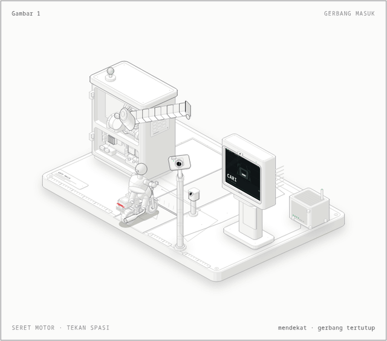
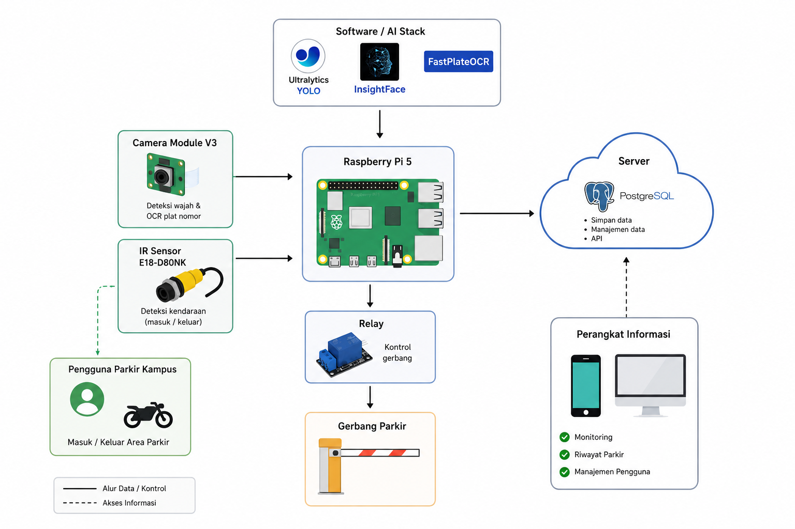

# Gerbang Masuk Parkir Kampus

Figure isometrik interaktif dan firmware Raspberry Pi 5 untuk gerbang masuk parkir kampus: kamera memindai wajah dan plat nomor, lalu relay membuka palang.

[Demo interaktif](https://zabduziz.github.io/parking-anatomy/demo/gerbang-masuk-light.html) · [Tema gelap](https://zabduziz.github.io/parking-anatomy/demo/gerbang-masuk.html) · [Firmware](firmware/gerbang-masuk.py)



## Apa ini

Figure ini menampilkan gerbang masuk parkir kampus sebagai benda isometrik: kabinet gerbang berisi Raspberry Pi 5 dan modul relay, lengan palang yang membuka 76°, kamera Module V3 di tiang, sensor IR E18-D80NK, layar informasi, kotak server, dan satu sepeda motor dengan pengendara. Figure disusun sebagai Gambar 1 untuk skripsi sistem parkir kampus.

Setiap angka yang tampil di figure berasal dari model yang sama dengan firmware: 5 frame stabil, pulsa relay 0,5 detik, penjagaan IR 2 detik, reset error 3 detik, dan stream 15 fps. Satu siklus yang diterima berjalan dari motor mendekat, pemindaian, relay, palang terbuka, motor lewat, sampai palang menutup. Saat dibiarkan, figure juga memperlihatkan siklus penolakan: plat tidak cocok, palang tetap tertutup, dan motor mundur.

## Alur masuk kendaraan

1. Kamera Module V3 menangkap frame 960×720. YOLO dengan `conf=0.6` mencari wajah (class 0) dan plat nomor (class 1).
2. Kedua deteksi harus bertahan selama `STABLE_THRESHOLD = 5` frame.
3. InsightFace `buffalo_s` menghitung face embedding di CPU. FastPlateOCR `cct-xs-v1-global-model` membaca plat dan rata-rata probabilitas karakternya.
4. Raspberry Pi mengirim POST multipart berisi `platNomor`, `faceEmbedding`, `userId`, `confidencePlat`, dan `gambar` ke `<base_url>/detection`.
5. Respons HTTP 200/201 memicu relay GPIO 23 (active-low) selama 0,5 detik. Palang terbuka 76°.
6. Status `WAITING_EXIT` menunggu 2 detik, lalu sensor IR GPIO 17 (pull-up) menutup siklus saat motor sudah lewat. Jika IR tidak pernah terbaca, timeout 5 detik menjadi cadangan.
7. Kegagalan masuk `COOLDOWN_ERROR` selama 3 detik. Respons `400` berarti kendaraan masih terparkir; selain itu dianggap error server. Setelah itu sistem kembali ke `SCANNING`.
8. Route `/stream` di port 5000 mengirim JPEG 480×360 kualitas 50 pada 15 fps ke frontend Vue.

## Arsitektur sistem



Camera Module V3 dan sensor IR E18-D80NK masuk ke Raspberry Pi 5 yang menjalankan YOLO, InsightFace, dan FastPlateOCR. Pi mengontrol relay dan palang, mengirim data ke server/PostgreSQL/API, dan menyediakan monitoring serta riwayat parkir untuk perangkat informasi.

## Demo interaktif

Seret motor di lajur, lalu lepaskan di garis berhenti untuk memindai. Tekan <kbd>Space</kbd> untuk mengirim satu motor. Jika tidak disentuh, figure menjalankan tur otomatis yang bergantian antara siklus diterima dan ditolak. Pengunjung dengan preferensi reduced-motion mendapat pose diam.

Kedua tema dibangun dari sumber yang sama. Animasi di README memakai build tema terang; tema gelap tersedia di [demo gelap](https://zabduziz.github.io/parking-anatomy/demo/gerbang-masuk.html).

## Struktur repositori

| Path | Isi |
| --- | --- |
| `src/build.mjs` | Geometri, animasi, dan generator halaman figure |
| `vendor/anatomy/` | Kit ISO Anatomy (MIT) dan loader yang di-vendor |
| `docs/demo/` | Halaman HTML standalone hasil build |
| `docs/media/gerbang-masuk-light.gif` | Animasi untuk README |
| `docs/arsitektur.png` | Diagram arsitektur sistem |
| `docs/index.html` | Halaman landing GitHub Pages |
| `firmware/gerbang-masuk.py` | Firmware Raspberry Pi 5 |
| `tools/record.mjs` | Perekam GIF deterministik |

## Menjalankan figure

Butuh Node.js 20.10 atau lebih baru. Tidak ada dependensi npm, jadi tidak perlu `npm install`.

```bash
npm run build        # docs/demo/gerbang-masuk.html
npm run build:light  # docs/demo/gerbang-masuk-light.html
npm run build:all
```

Buka file HTML yang dihasilkan langsung di browser. Halaman berdiri sendiri dan tidak memuat aset eksternal.

## Membuat ulang animasi README

Butuh `ffmpeg` dan browser Chromium/Chrome/Brave. Perintah berikut membangun ulang halaman tema terang lalu menulis `docs/media/gerbang-masuk-light.gif`:

```bash
npm run record
```

Jika browser tidak terdeteksi otomatis, set `CHROME_PATH`:

```bash
CHROME_PATH=/path/to/chrome npm run record
```

Jika GIF melebihi 5 MB, turunkan ukuran:

```bash
npm run record -- --width 560 --fps 12 --colors 160
```

## Firmware Raspberry Pi 5

Perangkat: Raspberry Pi 5, Camera Module V3, sensor IR E18-D80NK di GPIO 17, relay di GPIO 23, dan palang gerbang.

Dependensi di Pi: `ultralytics`, `picamera2` (apt), `insightface`, `fast_plate_ocr`, `flask`, `gpiozero` (apt), `numpy`, `opencv`, dan `requests`. Jalankan:

```bash
python firmware/gerbang-masuk.py
```

Ubah `base_url` di bagian atas file sesuai alamat backend (saat ini `http://100.98.50.107:3000`; `https://apiparkir.zabduziz.com` masih dikomentari). Model tidak disertakan di repositori ini: `runs/detect/train/weights/best.pt`, InsightFace `buffalo_s`, dan FastPlateOCR `cct-xs-v1-global-model`.

Backend, frontend Vue, model terlatih, dan perangkat fisik berada di luar repositori ini.

## Kredit

Figure dibuat dengan [Anatomy](https://github.com/wheresryan22/anatomy) karya Ryan, lisensi MIT. Subset kit yang dipakai ada di `vendor/anatomy/` beserta lisensinya. Tumpukan AI: Ultralytics YOLO, InsightFace, dan FastPlateOCR.
